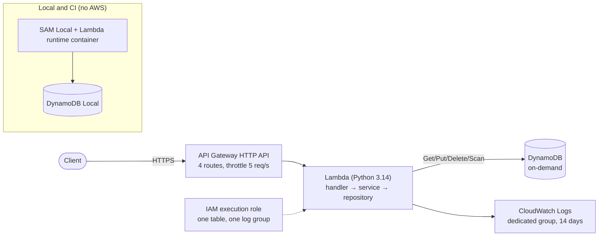

# Serverless Items CRUD API (AWS SAM)

[](https://github.com/davebushiri/aws-serverless-crud-api/actions/workflows/ci.yml)

A small create/read/update/delete API on **Amazon API Gateway (HTTP API) → AWS Lambda (Python 3.14) → Amazon DynamoDB**, defined as infrastructure as code with **AWS SAM**. It's built and tested entirely locally (Docker, DynamoDB Local, SAM Local), and checked in GitHub Actions without any AWS credentials.

> **Status:** portfolio and demonstration project, **not a production service**. The original tutorial version was deployed by hand in AWS, and its GET and PUT routes were tested through API Gateway. The refactored and hardened v2 code in this repository has been verified locally and in CI only; it has **not** been redeployed to AWS. It has no authentication and must not be exposed publicly as-is.

## Problem and objective

The AWS console tutorial produces a working API that can't be reproduced, isn't tested, runs with broad permissions, and crashes on bad input. The objective was to turn it into an engineering artifact that a reviewer can rebuild and test from scratch at **no AWS cost**, while keeping existing successful responses backward compatible:

- infrastructure in version control (SAM), with least-privilege IAM;
- code split into testable layers, with a documented, versioned API contract;
- automated unit and end-to-end tests against local emulators;
- independent CI evidence on a clean runner.

## Architecture



More diagrams (local stack, CI pipeline) and the design decisions: [docs/architecture.md](docs/architecture.md).

| Layer | Technology |
| --- | --- |
| API | Amazon API Gateway HTTP API (payload v2.0, Lambda proxy) |
| Compute | AWS Lambda, Python 3.14, x86_64, 128 MB |
| Data | Amazon DynamoDB, on-demand, partition key `id` |
| Observability | Amazon CloudWatch Logs (dedicated log group) |
| Security | IAM execution role (inline, scoped) |
| Infrastructure as code | AWS SAM (CloudFormation), cfn-lint |
| Local testing | Docker, DynamoDB Local 3.3.2, SAM CLI `local start-api`, moto, pytest |
| CI | GitHub Actions (manual trigger), uv with a hash-locked lock file |

## API (contract v2)

| Route | Success (200) | Errors |
| --- | --- | --- |
| `PUT /items` with `{"id", "price", "name"}` | `"Put item <id>"` | `400`, `413`, `500`, `503` |
| `GET /items/{id}` | `[{"price", "id", "name"}]` | `400`, `404`, `500`, `503` |
| `GET /items` | `[[{...}], ...]` | `500`, `503` |
| `DELETE /items/{id}` | `"Deleted item <id>"` | `400`, `404`, `500`, `503` |

Errors share one format: `{"error": {"code": "VALIDATION_ERROR", "message": "..."}}`. They never contain stack traces or internal details. Success bodies are unchanged from the original tutorial API. Schema, codes and the full v1 → v2 comparison: [docs/api-contract.md](docs/api-contract.md).

## Key engineering decisions

| Decision | Tradeoff |
| --- | --- |
| Serverless with an HTTP API: no servers, scales to zero, pay per request | No built-in request validation in HTTP APIs, so it's done in the Lambda |
| DynamoDB on-demand: single-key access, free when idle, official local emulator | Listing is a full-table `Scan` (one page, at most 1 MB) |
| Handler / service / repository layers | More files; in return, rules and error mapping are testable without AWS |
| Success responses kept identical to the original; only errors changed | Some inputs the original accepted are now rejected ([ADR 0001](docs/adr/0001-api-error-contract.md)) |
| Explicit execution role instead of SAM's default, which attaches `logs:*` on `*` | One more resource to maintain ([ADR 0002](docs/adr/0002-scoped-execution-role.md)) |
| Temporary DynamoDB failures → `503`, other faults → generic `500`; bounded boto3 timeouts and retries | Lambda timeout raised from 3 s to 6 s to stay above the worst case |
| Local-first testing with emulators | Zero AWS cost, but IAM, API Gateway and real DynamoDB limits stay unverified |

## Verified results

| Check | Result | Where |
| --- | --- | --- |
| Unit tests (validation, error contract, DynamoDB error classification, safe logging, IAM policy) | **79 passed** | `make test` |
| End-to-end HTTP tests through SAM Local → Lambda container → DynamoDB Local (CRUD, 400/404/413/500, 503 with the database stopped) | **19 passed** | `make local-test` |
| Compatibility with the original Lambda (same 17 requests; differences only where documented) | Pass | `tests/test_baseline_equivalence.py` |
| Template: cfn-lint, `sam validate --lint`, `sam build` | Clean / valid / succeeded | `make verify` |
| CI on a clean GitHub-hosted runner, no AWS credentials | Pass | [Actions runs](https://github.com/davebushiri/aws-serverless-crud-api/actions/workflows/ci.yml) |

Evidence and history: [docs/verification.md](docs/verification.md), recorded output in [docs/evidence/](docs/evidence/), CI details in [docs/ci.md](docs/ci.md).

### Verified vs. not verified

| Verified (locally and in CI) | Not verified (needs an AWS deployment) |
| --- | --- |
| Handler behavior for every route and error case | Stack creation under real account policies and quotas |
| Lambda Python 3.14 runtime behavior (official container image) | That the scoped IAM role is sufficient at runtime |
| DynamoDB reads and writes (DynamoDB Local), 503 on outage | API Gateway's own responses (for example `404` for unknown routes) and stage throttling |
| No internal details in error responses | Logs arriving in the dedicated CloudWatch log group |
| IAM policy content in the expanded template (static) | Real DynamoDB throttling and service-side limits |

## Run it locally

**Requirements:** Python 3.14, [uv](https://docs.astral.sh/uv/), `make`, `curl`, and Docker (for the local stack). No AWS account or credentials.

```bash
git clone https://github.com/davebushiri/aws-serverless-crud-api.git
cd aws-serverless-crud-api
make install        # .venv with the locked, hash-verified tools
make verify         # unit tests, cfn-lint, sam validate --lint, sam build (no Docker)
make local-test     # start DynamoDB Local + SAM Local, run the HTTP tests, tear down
```

Try the API yourself:

```bash
make local-up       # http://127.0.0.1:3000
curl -X PUT http://127.0.0.1:3000/items -H 'Content-Type: application/json' -d '{"id": "1", "price": 9.5, "name": "test"}'
curl http://127.0.0.1:3000/items/1
scripts/demo_requests.sh   # full CRUD and error walkthrough
make local-down     # stop everything and remove the containers
```

All local commands use synthetic credentials with `~/.aws` hidden, and only accept `localhost` endpoints.

## Security, cost and deployment limits

- **No authentication or authorization.** Anyone with the URL could read, write and delete. Add an authorizer before any real deployment.
- **Throttling** is one stage-wide limit (5 req/s, burst 10); there are no per-client limits, WAF rules or budget alarms.
- **Data:** synthetic only. No backups; deleting the stack deletes the table. Prices are returned as floats.
- **Cost:** development and CI make no AWS calls. If deployed, cost comes from requests, Lambda duration, DynamoDB usage and logs. An open endpoint can drive all of these, which is why authentication comes first.
- **Not deployed:** there's no deploy configuration or deploy workflow. Deployment would be a deliberate, separate step (`sam deploy --guided` into the project's Region, then `scripts/demo_requests.sh` against the endpoint).

Full review: [docs/security.md](docs/security.md).

## Documentation

| Document | Contents |
| --- | --- |
| [docs/architecture.md](docs/architecture.md) | Diagrams, resources, decisions, failure handling, limits of emulation |
| [docs/api-contract.md](docs/api-contract.md) | Contract v2: schema, error codes, v1 → v2 changes |
| [docs/security.md](docs/security.md) | IAM, authentication, validation, logging, dependencies, cost and data risks |
| [docs/adr/](docs/adr/) | Architecture decision records (error contract, execution role) |
| [docs/verification.md](docs/verification.md) | What was verified, how, and what wasn't, by milestone |
| [docs/ci.md](docs/ci.md) | CI workflow, security, cost controls, how to rerun |
| [docs/demo.md](docs/demo.md) | 2–3 minute demo: commands, expected output, speaking script |
| [docs/portfolio.md](docs/portfolio.md) | Resume, interview and LinkedIn material |
| [docs/completion-report.md](docs/completion-report.md) | Project closure report and checklist |

## Repository layout

```
template.yaml            SAM template: HTTP API, Lambda, DynamoDB, IAM role, log group
src/items_api/           handler.py, service.py, repository.py, errors.py
baseline/                Original tutorial Lambda, unchanged (reference only, not deployed)
tests/                   Unit tests; tests/integration/ for the local HTTP tests
scripts/                 local.sh (start/stop stack), local_table.py, demo_requests.sh, ci_summary.py
local/env.json           Environment for the local Lambda
.github/workflows/ci.yml CI workflow
Makefile                 install, verify, local-up, local-test, local-down, ...
```
