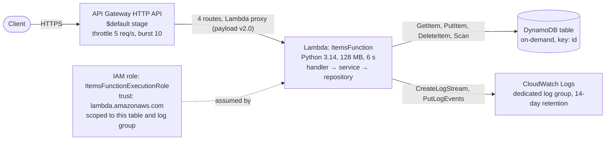
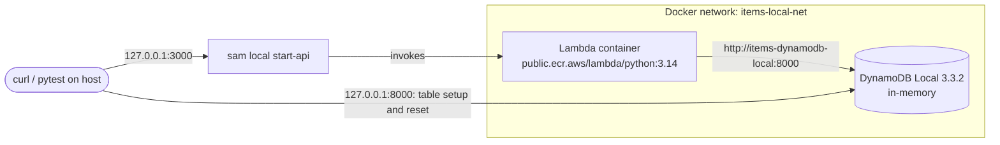
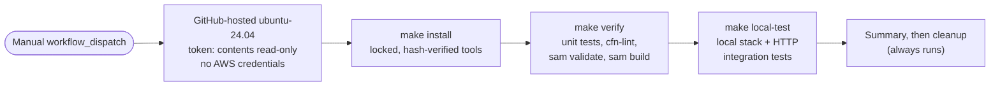

# Architecture

## AWS runtime (as defined in `template.yaml`)

The v2 code has **not** been deployed. The diagram shows what the template defines; the original tutorial version ran on this same API Gateway → Lambda → DynamoDB path in AWS.

| Resource | Key settings |
| --- | --- |
| `ItemsApi` (`AWS::Serverless::HttpApi`) | Routes `GET /items`, `GET /items/{id}`, `PUT /items`, `DELETE /items/{id}`; stage throttle 5 req/s, burst 10; no authorizer |
| `ItemsFunction` (`AWS::Serverless::Function`) | `python3.14`, x86_64, 128 MB, 6 s timeout; env `TABLE_NAME`, `DYNAMODB_ENDPOINT_URL` (empty in AWS) |
| `ItemsTable` (`AWS::DynamoDB::Table`) | `PAY_PER_REQUEST`, partition key `id` (String), generated name |
| `ItemsFunctionLogGroup` (`AWS::Logs::LogGroup`) | 14-day retention, used through the function's `LoggingConfig` |
| `ItemsFunctionExecutionRole` (`AWS::IAM::Role`) | Inline policy only; see [security.md](security.md#iam-permissions) |

## Local development (no AWS account)

`scripts/local.sh` starts and stops this stack (`make local-up`, `make local-down`). Credentials are synthetic (`local`/`local`), `~/.aws` is hidden, both ports bind to `127.0.0.1`, and the test helpers refuse any endpoint that isn't `localhost` or `127.0.0.1`. DynamoDB Local runs in memory with `-sharedDb`, and each integration test recreates the table.

## Continuous integration

Details: [ci.md](ci.md).

## Code structure

| Module | Responsibility |
| --- | --- |
| `src/items_api/handler.py` | Lambda entry point: routing, body size and JSON parsing, mapping errors to HTTP responses, catch-all `500`, safe logging |
| `src/items_api/service.py` | Item schema validation, not-found rules, success response shapes. No Lambda or AWS types. |
| `src/items_api/repository.py` | The only boto3 code: DynamoDB calls with bounded timeouts and retries, classification of DynamoDB errors |
| `src/items_api/errors.py` | Error classes with HTTP status, stable code and safe default message |
| `baseline/lambda_function.py` | The original tutorial Lambda, unchanged; reference for the compatibility tests (not deployed) |

## Key decisions

| Decision | Why | Tradeoff / alternative |
| --- | --- | --- |
| **Serverless (API Gateway + Lambda)** | No servers to patch, scales to zero, pay per request; a natural fit for a small CRUD API with uneven traffic | Cold starts and API Gateway's integration time limit (about 30 s); containers (ECS/Fargate) suit long-running or steady workloads better |
| **HTTP API rather than REST API** | Same as the tutorial; lower cost and latency | No built-in request validation, API keys or usage plans; validation is done in the Lambda |
| **DynamoDB, on-demand** | Single-key lookups map directly to `GetItem`/`PutItem`/`DeleteItem`; no capacity planning; costs nothing when idle; has an official local emulator | No ad-hoc queries or joins; listing is a `Scan`, which becomes expensive as the table grows |
| **AWS SAM** | Short serverless syntax on top of CloudFormation, with `sam build`, `sam validate` and `sam local` for an offline workflow | CDK is more expressive but adds another toolchain; plain CloudFormation is much more verbose |
| **Handler / service / repository layers** | Validation and business rules are testable without Lambda events or AWS; AWS-specific errors are translated in one place | More files than a single-function tutorial handler |
| **Explicit error contract (v2)** | Clients can tell their own mistakes (400/404/413) from server faults (500) and temporary outages (503); nothing internal leaks | Rejects some inputs the original accepted; see [ADR 0001](adr/0001-api-error-contract.md) |
| **Explicit, scoped execution role** | Avoids the managed policy SAM attaches by default (`logs:*` on `Resource: *`) | One more resource to maintain; see [ADR 0002](adr/0002-scoped-execution-role.md) |
| **Generated table name via `TABLE_NAME`** | No hard-coded names; several stacks can coexist | Name is less readable in the console |
| **14-day log retention, explicit log group** | Logs don't accumulate forever; the group is deleted with the stack | Older logs are lost |
| **No catch-all route** | Unknown paths are rejected by API Gateway without starting a Lambda | Those responses use the platform's format, not the v2 error format |

## Failure handling

| Failure | Where it's handled | Response |
| --- | --- | --- |
| Malformed or oversized body, invalid fields | `handler.parse_json_body`, `service.parse_item` | `400 INVALID_JSON` / `400 VALIDATION_ERROR` / `413 PAYLOAD_TOO_LARGE` |
| Item doesn't exist | `service.get_item`; conditional `DeleteItem` in the repository | `404 ITEM_NOT_FOUND` |
| DynamoDB throttling, DynamoDB 5xx, connection or timeout errors | `repository._dynamodb_errors` | `503 SERVICE_UNAVAILABLE` (retryable) |
| Missing table, access denied, any other exception | Catch-all in `handler.lambda_handler` | `500 INTERNAL_ERROR`, generic message; traceback logged server-side only |
| Slow dependency | boto3 config: 1 s connect, 1 s read, 2 attempts; Lambda timeout 6 s | `503` rather than a Lambda timeout |

## Local emulation: what it saves and what it can't verify

**Saves:** every build, test and demo runs on a laptop or a CI runner with no AWS account, so development and CI add no AWS cost, and nothing can accidentally change a live resource. The tests run the real handler inside the real Lambda Python 3.14 runtime image against a real DynamoDB engine.

**Can't verify** (see [verification.md](verification.md#not-verified-needs-a-real-aws-deployment)):

- IAM: DynamoDB Local and `sam local` don't enforce IAM, so the scoped role is checked only by static tests, not by AWS.
- API Gateway: real routing responses (404 for unknown routes), stage throttling (429) and the payload v2.0 event from the managed service.
- CloudWatch: that logs actually arrive in the dedicated log group.
- CloudFormation: that the stack creates under the account's SCPs and quotas.
- DynamoDB service behavior: throttling, consistency and service-side validation differences.

## Dependencies

| Tool | Used for | Version tested |
| --- | --- | --- |
| Python | Runtime and tests | 3.14.6 locally, 3.14.9 in CI |
| AWS SAM CLI | `validate`, `build`, `local start-api` | 1.170.0 |
| cfn-lint | Template linting | 1.58.0 |
| pytest / moto | Tests / in-memory DynamoDB for unit tests | 9.2.0 / 5.2.5 |
| boto3 | AWS SDK (provided by the Lambda runtime; not packaged) | 1.43.108 locally |
| Docker | DynamoDB Local and the Lambda runtime container | 29.9.2 locally, 28.0.4 in CI |
| DynamoDB Local | Local database | 3.3.2 |

All dev tools are pinned and hash-locked in `requirements-dev.lock`.
